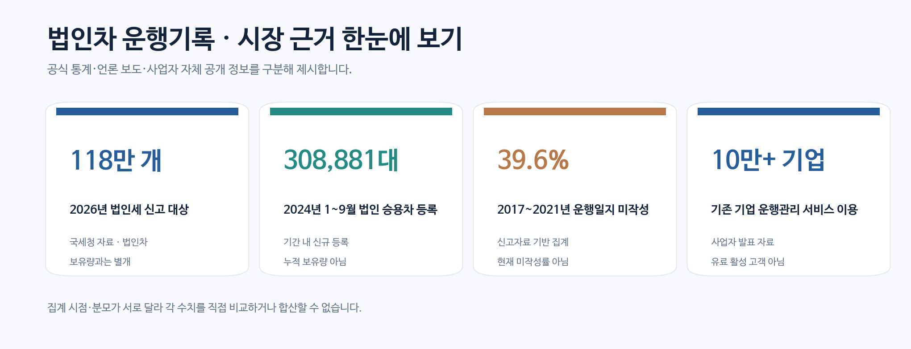
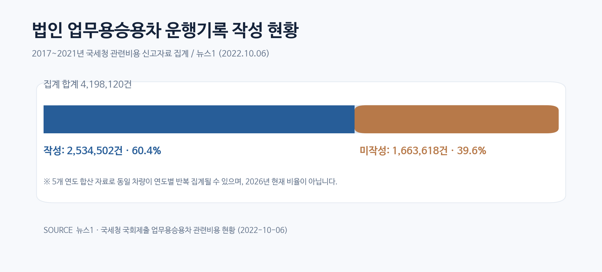
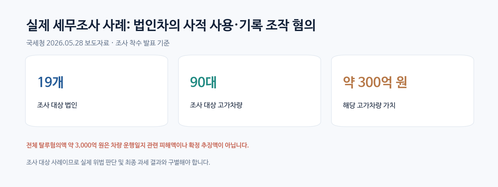
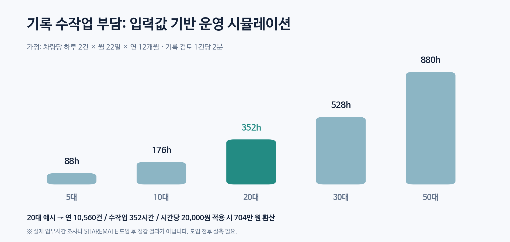
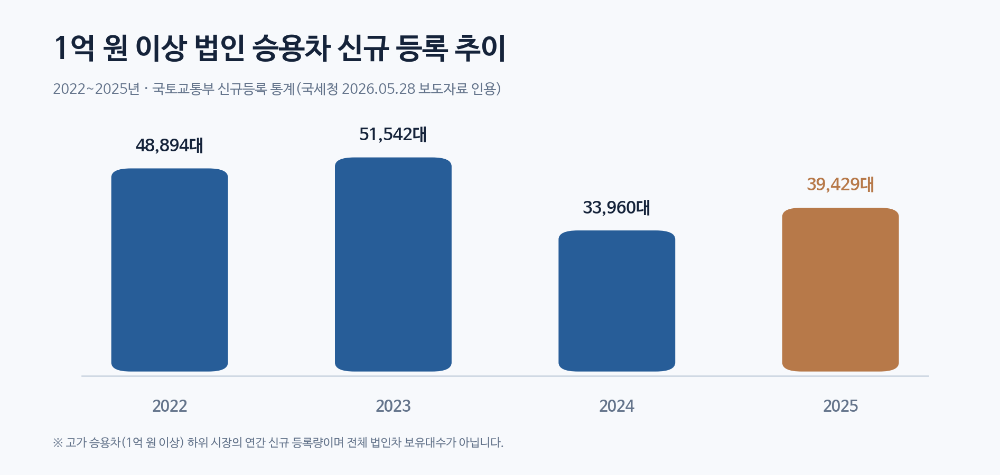
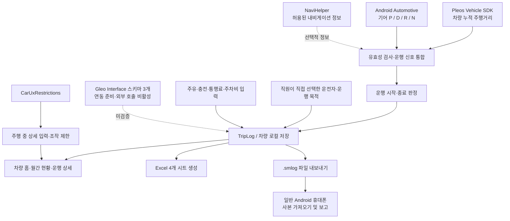
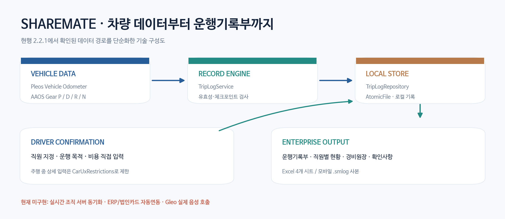

# SHAREMATE | 차량 자체에서 시작하는 법인차 자동 운행관리

> **Pleos Connect 기반 업무용승용차 운행기록·경비관리·증빙 지원 시스템**  
> 프로젝트 유형: Automotive Native App / Corporate Fleet Operations / Vehicle Data Integration  
> 분석 기준: 2026-10-28 · 코드 기준 버전: `2.2.1` (`versionCode 12`)  
> 대상: 법인차를 소유·리스·장기렌트하여 운영하는 기업의 운전자, 총무·차량관리자, 재무·회계·세무 담당자

**SHAREMATE는 차량의 실제 기어 상태와 누적 주행거리 데이터를 이용해 운행을 기록하고, 운전자의 업무 목적 확인과 경비 입력을 결합하여 기업의 운행기록부·비용 관리 자료를 만드는 차량 중심형 시스템이다.** 운전자가 주행을 마친 뒤 수기로 거리를 계산하거나 휴대폰 GPS 기록만으로 주행 사실을 판단하는 방식에서 출발해, **차량 내에서 기록을 발생시키고 차량·직원·업무목적·비용을 연결하는 방식**을 지향한다.

단, 본 프로젝트는 **세무 신고 프로그램이나 세금 자동 환급 시스템이 아니다.** 생성한 Excel은 국세청 운행기록 항목을 참고한 검토용 자료이며, 실제 비용의 손금 인정은 업무전용보험·업무 관련성·증빙·현행 법령 등에 따라 판단한다.


### 시장·기록 문제: 검증된 통계 요약



> **지표 해석 주의:** 2026년 법인세 신고 대상, 2024년 법인 명의 승용차 기간 등록, 2017~2021년 기록 미작성 비율, 기존 서비스의 누적 이용 기업 수는 각각 **모집단·시점·조사 주체가 다르다.** 이 수치를 합산하거나 법인차 보유 대수로 환산하지 않는다. 원문은 [국세청(2026)](https://g.nts.go.kr/samcheok/na/ntt/selectNttInfo.do?mi=2201&nttSn=1349142), [매일신문(2024)](https://www.imaeil.com/page/view/2024111012000539333), [뉴스1(2022)](https://v.daum.net/v/0lmdHXtnW2), [카택스 공식 가이드](https://docs.cartax.biz/guidebook/main/main)를 참조한다.

---

## 01. Executive Summary | 왜 개발했는가

기업은 업무용승용차를 운영하면서 다음 네 가지를 동시에 관리해야 한다.

1. **누가, 언제, 얼마나 운행했는가:** 차량별 누적거리와 실제 운전자를 대응시키는 운행기록
2. **무엇을 위해 운행했는가:** 출퇴근, 거래처 방문, 기타 업무, 개인 사용을 구분하는 목적 기록
3. **어떤 비용이 발생했는가:** 주유·충전, 통행료, 주차비 등의 사용 내역과 원본 증빙
4. **어떻게 소명할 것인가:** 회계 결산 및 과세관청의 요청에 대비한 차량별 운행기록부와 확인 가능한 기초자료

문제는 이 정보가 보통 **차량 계기판, 운전자 기억·수기 장부, 개인 휴대폰 앱, 법인카드 전표, 회사 Excel**로 분산된다는 것이다. SHAREMATE는 이 중 **차량 데이터에 기반한 거리·시각의 자동 취득**과 **운전자 확인에 기반한 목적·비용 정보**를 한 운행 단위로 묶는 데 집중한다.

### 핵심 가설

> 운행 시작·종료와 주행거리는 가능하면 차량에서 자동 취득하고, 주행의 업무 목적과 비용은 사람이 확인하도록 역할을 분리하면, 반복 입력 부담과 기록 간 불일치를 줄이는 데 도움이 될 수 있다.

이 가설은 **제품 설계 방향**이며, 고객사 실증을 통해 정량 검증해야 한다.

---

## 02. Problem Evidence | 실제 시장과 제도가 보여주는 문제

| 지표 | 공표 수치 | 시점·모집단 | SHAREMATE 관점에서의 의미 |
|---|---:|---|---|
| 법인세 신고 대상 | **118만 개 법인** | 2026년 신고 대상, 국세청 | 기업 관리 솔루션의 폭넓은 잠재 고객 기반. **차량 보유 법인 수는 아님** |
| 운행기록 미작성 비율 | **39.6%** | 2017~2021년 법인차 관련 비용 신고 자료, 419만 8,120대 집계 중 166만 3,618대 미작성 | 운행기록 관리의 과거 공백을 보여주는 수치. **2026년 현재 미작성률이나 중복 없는 고유 차량 수가 아님** |
| 2025년 국내 자동차 누적 등록 | **26,514,873대** | 2025년 말, 국토교통부 | 자동차 산업 규모의 배경 지표. **법인차나 유효시장 전체가 아님** |
| 2024년 1~9월 법인 승용차 등록 | **308,881대** | 2024년 1~9월 신규 등록, 카이즈유데이터연구소 집계 인용 보도 | **법인 명의 차량 등록의 실제 흐름**을 보여주는 기간 통계. 누적 운행 법인차 대수가 아님 |
| 2025년 국내 렌터카 인가 대수 | **1,296,233대** | 2025년 말, 한국렌터카사업조합연합회 통계를 인용한 기업 공시 | 법인 장기렌트가 속한 인접 시장의 참고 지표. **개인·단기 렌트도 포함되어 법인차 대수로 사용할 수 없음** |
| 1억 원 이상 법인 승용차 신규 등록 | **39,429대** | 2025년, 국토교통부 통계를 인용한 국세청 자료 | 기업 명의로 새로 등록되는 차량이 실제 존재함을 확인하는 하위 집단. **전체 법인차 신규 등록이나 누적 보유량이 아님** |
| 기존 디지털 솔루션 도입 신호 | **10만 기업 이상** | 카택스 공식 사이트의 누적 기업 가입·사용 소개 | 운행일지 업무에 유료·무료 소프트웨어 수요가 존재한다는 경쟁사 자체 공개 지표. **독립 검증된 활성 유료 고객 수는 아님** |

**출처:** [국세청 2026년 법인세 신고 안내](https://g.nts.go.kr/samcheok/na/ntt/selectNttInfo.do?mi=2201&nttSn=1349142) · [국세청 자료를 인용한 2022년 뉴스1 보도](https://v.daum.net/v/0lmdHXtnW2) · [국토교통부 2025년 자동차등록 통계](https://gits.gg.go.kr/web/newboard/3386.do?idx=198617804&mode=view) · [2024년 법인 승용차 등록 현황 보도](https://www.imaeil.com/page/view/2024111012000539333) · [2026년 공시자료의 렌터카 등록 통계](https://cdn.financialreports.eu/financialreports/media/filings/16040/2026/RNS/16040_rns_2026-03-16_8085e59e-e081-4e8f-a7c1-75970a7019cc.html) · [국세청 2026-05-28 발표](https://d.nts.go.kr/boryeong/na/ntt/selectNttInfo.do?bbsId=1028&mi=2201&nttSn=1351916) · [카택스 공식 사이트](https://cartax.biz/).

### 2.0 운행기록 미작성 비율: 원자료 기반 그래프



| 구분 | 2017~2021년 집계 건수 | 비중 |
|---|---:|---:|
| 운행기록 작성 | 2,534,502건 | 약 60.4% |
| 운행기록 미작성 | 1,663,618건 | 약 39.6% |
| **합계** | **4,198,120건** | **100.0%** |

**근거:** 2022년 10월 6일 뉴스1 보도에 인용된 국세청의 국회 제출 「업무용승용차 관련비용 현황」. 연도별로 같은 차량이 반복 집계됐을 가능성이 있으므로 **고유한 차량 419만 대 또는 2026년 현재 법인차 미작성률로 표현하지 않는다.** [기사 원문 확인](https://v.daum.net/v/0lmdHXtnW2).

### 2.1 실제 운행기록을 요구하는 법적·실무적 배경

「법인세법」 및 같은 법 시행령 제50조의2는 업무용승용차 관련 비용을 계산할 때 **업무전용자동차보험, 업무사용비율, 운행기록 등**의 조건을 규정한다. 국세청의 「업무용승용차 운행기록 방법에 관한 고시」는 차종·자동차등록번호·사용일자·사용자·운행내역이 포함된 서식으로 기록할 수 있도록 한다. 업무목적은 추가로 출장명령서, 차량관리 규정 등의 자료로 소명해야 할 수 있다.

**일반적인 연간 1,500만 원 기준은 모든 기업이 무조건 공제받는 금액이 아니다.** 운행기록을 작성·비치하지 않은 경우 업무사용비율을 계산하기 위한 기준으로, 보유기간, 사업연도, 특정 법인에 적용되는 별도 한도, 업무전용보험·전용번호판, 감가상각비 한도 등 다른 조건이 함께 적용된다. 또한 **출퇴근은 관련 규정에서 인정될 수 있는 업무사용거리 항목이므로**, 단순히 회사로 출퇴근했다는 사실만으로 자동 부인하지 않고 실제 업무 관련성 및 현행 세법을 검토해야 한다.

- 법령: [법인세법 시행령 제50조의2](https://law.go.kr/lsLinkCommonInfo.do?chrClsCd=010202&lsJoLnkSeq=1022761025)
- 운행기록 방법: [국가법령정보센터 — 업무용승용차 운행기록 방법에 관한 고시](https://www.law.go.kr/admRulInfoP.do?admRulSeq=2100000282834)
- 국세청 안내: [업무용승용차 비용처리기준](https://www.nts.go.kr/nts/na/ntt/selectNttInfo.do?nttSn=93552)

### 2.2 실제 적발·추징 사례: 운행기록과 비용증빙의 불일치

**사례 A — 업무용승용차 사적 사용에 따른 비용 부인 사례(과거 세무교육 자료)**  
국세청의 2022년 법인세 신고 안내 교육자료에는 다수의 고가 차량을 법인 명의로 보유한 제조업체에서 대표이사 및 가족 등이 차량을 사적으로 사용했음에도 관련 비용을 전액 업무용으로 처리한 사례가 제시되어 있다. 과세당국은 **차량 운행기록부와 유지관리비 지출증빙을 검토**하여 사적 사용 관련 비용의 손금 인정 여부를 판단했다. 교육자료에 금액은 비식별 표기되어 있어 구체적인 추징세액을 산정할 수 없다.  
[출처: 국세청 법인세 신고 안내 교육자료(2022년, 대한상공회의소 지역상공회의소 공개 자료)](https://jejucci.korcham.net/file/dext5uploaddata/2022/1.%20%EB%B2%95%EC%9D%B8%EC%84%B8%20%EC%8B%A0%EA%B3%A0%EC%95%88%EB%82%B4_.pdf)

**사례 B — 2026년 법인 고가차량 세무조사 발표(조사 단계)**  
국세청은 2026년 5월 28일 **19개 법인**의 탈루 혐의 조사를 발표했다. 이들이 소유한 고가 차량은 **90대, 약 300억 원 상당**으로 제시되었고, 법인 자금 유출·편법 증여 등을 포함한 **전체 탈루혐의 금액 약 3,000억 원**이 언급되었다. 일부 차량의 사적 사용, 운행기록 조작 의혹도 조사 배경에 포함된다. **3,000억 원은 법인차 운행일지 때문에 발생한 손실이나 확정 추징세액이 아니다.**  
[출처: 국세청 보도자료, 2026-05-28](https://d.nts.go.kr/boryeong/na/ntt/selectNttInfo.do?bbsId=1028&mi=2201&nttSn=1351916)

두 사례가 제시하는 핵심 과제는 **'운행기록이 존재하는가'를 넘어 '차량 데이터, 사용자, 목적, 카드·주유·통행 기록을 대조할 수 있는가'**이다. SHAREMATE는 이를 위한 기초 운행정보와 경비원장을 통합하되, **법인카드·하이패스 자동 수집, 허위 기록 자동 적발, 부정사용 판정은 현재 구현되어 있지 않다.**

### 2.3 관련 기사·공식 발표: 직접 열람 가능한 자료

기사 본문과 사진을 허가 없이 복제하지 않고, **원문 링크·발행일·핵심 수치·자료 성격**을 정리했다. 각 링크를 누르면 언론사 또는 기관의 원문으로 이동한다.

| 발행일 | 기사·발표 자료 | 핵심 데이터와 시사점 | 증거 구분 |
|---|---|---|---|
| 2022-10-06 | [뉴스1 — 법인차 운행일지 미작성 문제](https://v.daum.net/v/0lmdHXtnW2) | 과거 5년 신고자료 집계 중 39.6% 미작성. 기록 관리 공백을 보여주는 자료 | 국세청 국회 제출자료 인용 보도 |
| 2024-11-10 | [매일신문 — 고가 법인차 연두색 번호판 회피 논란](https://www.imaeil.com/page/view/2024111012000539333) | 2024년 1~9월 법인 승용차 308,881대 기간 등록. 신규 등록 규모이지 누적 보유량이 아님 | 카이즈유 집계 인용 보도 |
| 2025-01-20 | [카택스 — 누적 회원 10만 기업 돌파 발표](https://blog.cartax.biz/entry/%EC%B9%B4%ED%83%9D%EC%8A%A4-%EB%88%84%EC%A0%81-%EA%B8%B0%EC%97%85-%ED%9A%8C%EC%9B%90-10%EB%A7%8C-%EB%8F%8C%ED%8C%8C%E2%80%A6%E2%80%992024-%EC%97%B0%EB%A7%90%EA%B2%B0%EC%82%B0%E2%80%99-%EA%B3%B5%EA%B0%9C) | 누적 가입 기업 10만, 관리 차량 18만 대 발표. 경쟁 서비스 수요 지표 | **경쟁사 자체 발표**, 제3자 검증치 아님 |
| 2026-02-23 | [국세청 — 118만 법인 법인세 신고 안내](https://g.nts.go.kr/samcheok/na/ntt/selectNttInfo.do?mi=2201&nttSn=1349142) | 법인세 신고 대상 약 118만. 실제 차량 보유 법인 수와 구별 | **공식 보도자료** |
| 2026-05-28 | [국세청 — 법인차 사적 사용 혐의 세무조사](https://d.nts.go.kr/boryeong/na/ntt/selectNttInfo.do?bbsId=1028&mi=2201&nttSn=1351916) | 조사 대상 19개 법인, 고가차량 90대·약 300억 원 상당 | **공식 조사 착수 발표**, 확정 추징 아님 |
| 2026-09-10 | [한스경제 — 카택스 관리자 모바일 기능 확대](https://www.mimint.co.kr/bbs/view/news/S1N11/5574807?page=3) | 기존 기업용 운행관리 서비스의 자동 기록·관리자 기능 경쟁 환경 확인 | 사업자 발표를 인용한 기사 |

**산업적 의미:** 국내에는 이미 스마트폰 기반 자동 운행관리 서비스가 존재한다. SHAREMATE가 검증해야 할 차별점은 **독점적인 자동기록 기능이 아니라, Pleos 차량 내부에서 지원되는 기어·누적거리 신호로 운행을 시작하고 안전한 정차 후 확인 흐름까지 연결하는 설계**다.



**그림 해석:** 19개 법인, 90대, 약 300억 원은 *조사 착수 발표상* 대상 범위다. 법인차 운행기록 관련 확정 손실액 또는 SHAREMATE 도입 시 절감 가능 비용으로 해석하지 않는다. [국세청 원문](https://d.nts.go.kr/boryeong/na/ntt/selectNttInfo.do?bbsId=1028&mi=2201&nttSn=1351916).

---

## 03. Target Users | 누가 왜 필요한가

| 사용자/도입 주체 | 실제 업무·불편 | 요구 기능 | SHAREMATE의 현재 대응 |
|---|---|---|---|
| **차량 3~30대 운영 중소기업** | 운전자와 차량이 수시로 바뀌고 월말 수기 취합에 시간 소요 | 자동 거리 기록, 직원 지정, 월간 보고 | 차량 신호 기반 기록·직원별 조회·Excel |
| **현장영업·시설점검·서비스 기업** | 일일 방문 운행이 많아 출발·도착거리 및 출장 구분을 반복 입력 | 운행 단위 자동화, 목적 분류, 경비 연결 | 기어·계기판 기반 감지·목적 선택·경비 등록 |
| **기업 총무·차량관리자** | 공용차량별 사용자와 미분류 운행 파악이 어려움 | 차량·직원·기간별 사용 현황 | 직원별·월별 현황 및 확인사항 시트 |
| **재무·회계·세무 담당자** | 카드전표와 운행 내역을 대조하고 결산 자료를 반복 정리 | 운행기록부, 업무사용비율, 경비원장, 검토 항목 | 4개 시트 `.xlsx` 생성 및 입력 누락 점검 |
| **실제 운전자·임직원** | 개인 휴대폰 GPS·배터리·권한 관리, 수동 시작/종료와 사후 입력 부담 | 차량 내 이용자 선택, 최소 조작, 정차 후 확인 | 차량 자동 운행 감지·직원 선택·정차 후 목적 확인 |

초기 도입 적합도가 높은 고객은 **차량 자체에서 신호를 읽을 수 있는 Pleos 적용 차량을 운영하고, 운행기록과 경비를 아직 분리된 수기/Excel 프로세스로 관리하는 법인**이다. 일반 차량 전체에 즉시 적용할 수 있는 범용 앱이라고 주장하지 않는다.

---

## 04. Problem Definition | 수기·스마트폰·비용처리의 구조적 한계

| 문제 | 수기/일반적인 작업 방식에서 발생할 수 있는 원인 | 기업에 미치는 영향 | 기술적 해결 전략 |
|---|---|---|---|
| **P1. 운행기록 누락** | 주행 후 수동 작성, 운전자 교대, 앱 실행·종료 누락 | 운행 건수·거리의 공백과 사후 확인 업무 | 차량 기어 전환 및 누적거리 기반 운행 이벤트 생성 |
| **P2. 거리 근거의 불일치** | 계기판·휴대폰 GPS·사용자 입력 거리의 측정 방식 차이 | 담당자 재검증, 엑셀 정정, 비용 산정 혼선 | 차량 제공 계기판 누적거리의 유효값 사용 |
| **P3. 업무 목적 미분류** | 출장/출퇴근/개인 사용을 일괄 기입하거나 누락 | 업무사용비율 산출·소명 어려움 | 주행 후 직원이 목적 확정, 미지정 상태 별도 표시 |
| **P4. 비용·운행 분리** | 주유비·통행료 등 전표와 운행기록을 별도 보관 | 월말 대사 업무, 이중 입력, 누락 가능성 | 운행 상세에 경비 항목 연결, 비용 원장 출력 |
| **P5. 담당자 의존형 관리** | 직원별 파일 취합, 중앙 관리표 수작업 병합 | 데이터 형식 불일치, 담당자 변경 시 업무 단절 | 직원·기간별 집계와 표준화된 `.xlsx` 생성 |
| **P6. 차량 정보의 모바일 종속** | 개인 휴대폰의 GPS 권한·절전·연결 상태에 영향 | 일부 상황에서 위치 측정·기록 누락 위험 | 차량용 SDK 기반 이벤트 기록으로 거리 수집 경로 분리 |

**비교 시 주의:** 스마트폰 앱이 모두 수동인 것은 아니다. 예컨대 [카택스](https://cartax.biz/)는 GPS와 블루투스·충전·비콘 기반 자동 감지를 제공하고, 제네시스 개발자 사이트에는 [커넥티드카 주행거리 연동 활용 사례](https://developers.genesis.com/web/v1/genesis/cartax)도 안내된다. SHAREMATE의 차별점은 '경쟁사에는 자동 기록이 없다'가 아니라 **Pleos 지원 차량 내에서 실제 차량 신호와 주행 안전 제약을 이용해 운행기록·확인·내보내기 워크플로를 직접 구성한다는 구현 위치와 통합 방식**이다.

### 4.1 기업의 수작업 부담: 계산 예시(실측치 아님)

운행기록을 사람이 **건당 2분**에 작성·검토하고 인건비 환산 단가를 **시간당 20,000원**으로 가정한 예시다.

| 가정 | 값 |
|---|---:|
| 운영 차량 | 20대 |
| 차량당 일일 기록 | 2건 |
| 월 운행일 | 22일 |
| 연간 운행기록 | `20 × 2 × 22 × 12 = 10,560건` |
| 연간 수기 처리시간 | `10,560 × 2분 = 352시간` |
| 환산 인건비 규모 | `352시간 × 20,000원 = 7,040,000원/년` |

**이 704만 원은 통계 조사나 SHAREMATE 도입 효과가 아니라 입력값에 따른 가상 계산이다.** 자동 기록 후에도 직원 선택, 목적 확인, 오류 정정, 증빙 대사가 남으므로 전액 절감으로 해석할 수 없다. PoC에서 `기존 처리시간 - 도입 후 처리시간`을 직접 측정해야 한다.



*그래프 데이터:* `운영 차량 × 하루 2건 × 월 22일 × 연 12개월 × 건당 2분 ÷ 60`에 따른 연간 작업시간. **업무시간에 대한 실측 통계가 아니며 절감 효과를 뜻하지 않는다.** 기업 PoC에서 같은 기준으로 기존·도입 후 업무시간을 별도 측정해야 한다.

### 4.2 비용처리 리스크: 계산 예시(세액 아님)

차량 1대의 연간 관련비용이 **2,000만 원**, 업무전용보험 등 다른 법적 요건을 충족하고, 운행기록을 작성하지 않은 일반적인 1,500만 원 기준이 적용된다고 가정한다면, **500만 원은 운행기록이 없다는 조건에서 기준을 초과하는 비용**이다. 반면 운행기록에 의해 실제 업무사용비율 90%가 소명된다면 `2,000만 원 × 90% = 1,800만 원`이 업무사용액 산정의 출발점이 될 수 있다. 다만 **감가상각비 연간 한도 등 별도 조정이 필요하고, 300만 원 차이를 실제 절세액으로 단정할 수 없다.**

이 예시는 운행자료 보유가 왜 중요한지 설명하기 위한 것이며, 사용자의 실제 세무 결과를 예측하지 않는다.

---

## 05. Market Sizing | 시장 기회와 산정의 경계

### 5.1 검증 가능한 시장 범위

- **광의의 기업 기반:** 2026년 법인세 신고 대상 약 **118만 법인**. 이 가운데 업무용승용차 보유·운영 사업자 비율은 해당 숫자만으로 알 수 없다.
- **법인 차량의 실제 등록 흐름:** 2024년 1~9월 **법인 승용차 30만 8,881대** 등록(카이즈유데이터연구소 인용 보도). 이는 기간 중 신규 등록이지 운행 중인 모든 법인차 수가 아니다.
- **자동차 산업 기반:** 2025년 자동차 등록 **2,651만 4,873대**. 개인·법인·사업용 등 전체 자동차가 포함된다.
- **인접 장기렌트·리스 관련 지표:** 2025년 렌터카 인가 대수 **129만 6,233대**. 개인 이용과 단기렌트 등이 섞여 있으며 SHAREMATE의 직접 TAM이 아니다.
- **실제 경쟁 서비스의 이용 규모:** 카택스의 **누적 10만 기업 이상**이라는 자체 공시성 소개는 업무용 차량관리 소프트웨어의 상업적 수요를 나타내지만, 중복·활성·유료 여부를 알 수 없으므로 시장 침투율 산정에는 그대로 사용하지 않는다.

**따라서 현 자료만으로 '국내 법인차 총 보유 대수 = X대', '법인차 운행일지 시장 = Y억 원'이라고 확정하지 않는다.** 실제 TAM 산정을 위해 자동차등록원부의 소유주체·차종별 집계, 장기렌트 법인 계약 비중, Pleos 적용 차종·보급 대수, 고객의 서비스 지불의사를 별도로 확보해야 한다.

### 5.1.1 공식 통계: 1억 원 이상 법인 승용차 신규 등록 추이



| 연도 | 1억 원 이상 법인 승용차 신규 등록 |
|---|---:|
| 2022년 | 48,894대 |
| 2023년 | 51,542대 |
| 2024년 | 33,960대 |
| 2025년 | 39,429대 |

**출처:** 국토교통부 법인 승용차 신규등록 현황을 인용한 [국세청 2026-05-28 보도자료](https://d.nts.go.kr/boryeong/na/ntt/selectNttInfo.do?bbsId=1028&mi=2201&nttSn=1351916). 본 도표는 **1억 원 이상 고가차량 하위 집단**의 연간 신규 등록만 나타낸다. 모든 법인차나 Pleos 적용 차량 수를 나타내지 않으므로 직접 TAM 산정에 사용하지 않는다.

### 5.2 상업화 규모 시나리오(확정 시장규모가 아님)

아래는 **법인 1곳당 평균 10대, 차량당 월 이용료 10,000원**이라는 *가상 가격·고객 수*를 가정한 연 반복매출(ARR) 예시다.

| 도입 법인 수(가정) | 관리 차량 수(가정) | 월 이용료 합계 | 연간 반복매출(가정) |
|---:|---:|---:|---:|
| 100곳 | 1,000대 | 1,000만 원 | **1.2억 원** |
| 1,000곳 | 10,000대 | 1억 원 | **12억 원** |
| 5,000곳 | 50,000대 | 5억 원 | **60억 원** |

이는 **사업성 모델을 검토하기 위한 시뮬레이션이지 시장조사 결과, 실제 매출, 확정 가격정책이 아니다.** 플랫폼 접근·유통·데이터 정책에 관한 완성차 기업과의 협의가 선행되어야 한다.

### 5.3 우선 진입 전략

1. **PoC:** Pleos 테스트 환경과 협력 기업 1~3곳, 5~20대 수준의 실제 운행 프로세스로 데이터·UX 검증
2. **제품 검증:** 차량 자동 기록과 직원 확인 기록의 차이, 기록 누락률, Excel 결산 검토 시간을 측정
3. **고객 도입:** 통합 인사·차량 사용자 정보와 비용증빙 검증 프로세스 표준화
4. **확장:** 승인된 API·보안 계약에 따라 조직 서버, 관리자 대시보드, ERP·법인카드 연계 검토

---

## 06. Solution | SHAREMATE가 해결하는 방식

### 차량에서 기록을 시작하고, 사람이 목적을 확정하며, 회사가 검토한다

1. **차량 등록·운전자 선택:** 법인명, 차량번호, 직원 목록을 설정하고 이번 운전자를 명시적으로 선택한다. 음성이나 센서만으로 운전자 신원을 추정하지 않는다.
2. **운행 자동 감지:** 지원되는 차량의 `P → D/R/N` 전환과 누적 주행거리 유효값으로 운행 기록을 시작한다.
3. **운행 종료 기록:** `D/R/N → P` 후 최신 누적거리 응답을 얻어 운행거리와 종료 시점을 확정한다. 기준 미달 단거리 운행은 소프트웨어 규칙에 따라 제외한다.
4. **업무 목적 확인:** 주차 후 출퇴근·일반 업무·개인 운행을 운전자가 선택한다. 미확인 운행은 확인 필요 상태로 관리한다.
5. **경비 연결:** 주유·충전, 통행료, 주차 및 기타 경비를 관련 운행에 등록한다. 입력 금액은 실제 결제나 영수증 자동 검증을 의미하지 않는다.
6. **월간 운영·증빙:** 직원별/월별 운행거리·업무 비율·경비 및 정산 참고액을 확인하고 Excel 4개 시트로 내보낸다.
7. **휴대폰 열람:** 차량에서 저장한 완료 운행 `.smlog` 파일을 휴대폰에 옮기고 가져오면 해당 시점의 자료를 조회·내보낼 수 있다. **자동 무선 동기화나 조직 서버는 현재 구현하지 않았다.**

### 시스템 구조





*시스템 흐름도는 구현 코드의 역할을 단순화한 설명용 도해다.* 실제 파일 보안 서버, ERP 자동 동기화, Gleo 실기 음성 연결이 구현되었다는 의미가 아니다.

**설계 원칙:** 운행 주행 데이터는 **차량 신호 기반 사실 정보**, 직원·목적·경비는 **사용자 입력 정보**로 분리한다. 양쪽을 같은 신뢰수준으로 표현하지 않는다.

---

## 07. Pleos 기술 활용 | SDK·차량 시스템 상세

| 플랫폼/시스템 | 실제 사용 지점 | 구현 목적 | 주의 사항 |
|---|---|---|---|
| **Pleos Connect Vehicle SDK 2.3.2** | `Vehicle.getOdometer().getCurrentDistanceDriven()` 및 변화 리스너 | 차량 제공 누적거리 취득, 운행거리 계산 | Capability·권한·값의 유효성을 확인. 미지원·오류를 0km로 대체하지 않음 |
| **AAOS CarPropertyManager** | `VehiclePropertyIds.GEAR_SELECTION` | P·D·R·N 상태로 시작·종료 이벤트 판정 | `P` 여부를 속도 0만으로 추정하지 않음. 신호 무효 시 상태를 불명 처리 |
| **Pleos NaviHelper 3.0.5** | 내비게이션의 허용된 목적지/현재 위치 관련 정보 조회 경로 | 운행 관련 위치·목적지 보조 정보 | 이용 가능한 권한과 제공 범위에 종속. 지도 경로를 직접 바꾸지 않음 |
| **Android Automotive CarUxRestrictions** | `CarUxRestrictionsManager` 리스너 | 주행 중 직원 선택·경비 입력·설정 등 상세 UI 제한 | 차량 플랫폼 제한을 우회하지 않음. 상태 확인 불가 시 보수적으로 차단 |
| **Android Foreground Service** | `TripLogService` | 화면과 별개로 허용된 차량 신호의 운행기록 관리 | 차량 플랫폼 및 OS 생명주기 제약 존재. 장기·부팅 후 자동 재시작 실증 필요 |
| **Jetpack Compose + StateFlow** | 차량용·휴대폰용 화면, 상태 구독 | 운행·월간 경비 UI와 주야간·반응형 레이아웃 | 실제 차종별 화면·심사 적합성 확인 필요 |
| **AtomicFile / 앱 전용 저장소** | 운행 기록·설정 저장 | 기록의 로컬 보존 및 중단·오류 복구 지원 | 서버 다중 백업, 변조방지 원장, 원격 감사로그는 제공하지 않음 |
| **Excel Open XML(.xlsx)** | `LogbookExcel.kt` | 회계 검토용 운행기록부/경비원장 생성 | 신고·국세청 전송·영수증 생성 기능이 아님 |
| **Gleo Interface** | `assets/schema.json`, Gleo 액션 처리기 | 운행 목적/비용/운행요약 3개 음성 동작 준비 | 스키마·로직 준비 단계. 승인·호출자 인증·실제 Gleo 연결 미완료 |

### 7.1 차량의 실제 주행거리 사용

핵심 데이터는 휴대폰 GPS에서 위치 좌표를 적분한 추정거리가 아니라 **지원 차량이 제공하는 누적 주행거리**다.

```text
운행거리(km) = 종료 시 유효한 계기판 누적거리 - 시작 시 유효한 계기판 누적거리
```

- 유효한 차량 누적거리·기어 신호가 있을 때만 계산한다.
- 신호 수신 시각이 **45초 이상 오래되면** 정상적인 최신 값으로 취급하지 않는다(현재 코드의 freshness 경계 45,000ms).
- 누적거리가 감소하거나 값이 불연속인 상황을 임의 거리로 보정하지 않는다.
- 진행 중에는 **1분 또는 1km** 단위 체크포인트를 남기도록 설계되어 있다.
- **10분 이상 신호가 끊긴 후 복귀**한 경우 마지막 유효 체크포인트를 기준으로 확인 필요 상태로 종료하고, 미수신 구간의 거리를 지어내지 않는다.
- **0.1km 미만이면서 3분 미만**인 짧은 운행은 현재 저장 정책에 따라 기록에서 제외한다.

위 수치는 프로젝트 소스와 기술 문서의 **구현 규칙**이지 실제 도로에서 측정한 정확도·누락률·신뢰성 성능이 아니다. 차량이 제공하는 계기판 값과 법률상 최종 운행기록의 일치 여부는 실제 차량·권한·주행 데이터로 검증해야 한다.

### 7.2 주행 안전: 차량용 앱의 본질적 차별화

- 차량 앱은 `CarUxRestrictions`를 구독해 상세 조작을 제한한다.
- 주행 중 운전자의 입력을 요구하지 않고 **정차 후** 운행 목적·비용을 확인하는 사용자 흐름을 택한다.
- 화면이 차단되더라도 허용되는 차량 신호의 기록 기능은 별도 서비스 경로에서 관리한다.
- 플랫폼이 제공하는 주행 안전 정책을 임의로 해제하지 않는다.

### 7.3 Gleo AI 통합 설계(현재 준비 단계)

프로젝트에는 Gleo Interface 스키마 및 다음 세 가지 액션의 처리 로직이 준비되어 있다.

| 액션 | 의도한 명령 예시 | 기능 |
|---|---|---|
| `SET_TRIP_PURPOSE` | “이번 운행을 업무로 기록해줘” | 현재 또는 최근 운행 목적·메모 입력 |
| `ADD_TRIP_EXPENSE` | “주차비 3,600원 기록해줘” | 경비 종류·금액 등록 |
| `GET_DRIVING_LOG_SUMMARY` | “이번 달 업무거리와 유류비 알려줘” | 기간별 거리·비용·확인 항목 요약 |

공식 App Schema는 최대 **3개 actionCalls**를 정의한다. **현재 실제 Gleo 음성 인식 및 외부 호출 연결은 완료되지 않았다.** 외부 호출 수신기는 발신자 보안 계약이 확인되기 전까지 닫혀 있으며, 내부 버튼을 이용한 튜토리얼은 음성 연동 실증이 아니다.

**공식 기술 문서**
- [Pleos Vehicle API — 누적 주행거리](https://document.pleos.ai/api-reference/connect-sdk-pleos/Vehicle/vehicle/ai.pleos.playground.vehicle.api/odometer/get-current-distance-driven)
- [Pleos NaviHelper](https://document.pleos.ai/docs/pleos-only/connect-sdk-pleos/NaviHelper/destinations)
- [Pleos 주행 규제 개발 가이드](https://document.pleos.ai/docs/pleos-only/vehicle-app-developer-guide/driving-restriction-development-guide)
- [Gleo App Schema 작성 가이드](https://document.pleos.ai/docs/pleos-only/app-integration-guide/guide/app-capability)
- [Gleo Callback](https://document.pleos.ai/docs/pleos-only/app-integration-guide/guide/action_callback)

---

## 08. 현재 구현된 산출물

| 기능 | 현재 구현 범위 | 증빙 소스/문서 |
|---|---|---|
| 차량용 법인차 운행일지 홈 | 운행 상태, 계기판 누적, 월간 업무 비율, 직원 선택 | [`MainActivity.kt`](app/src/main/java/ai/sharemate/app/MainActivity.kt), [`LogbookUi.kt`](app/src/main/java/ai/sharemate/app/LogbookUi.kt) |
| 차량 신호 기반 자동 기록 | 기어·누적거리 유효성 검증, 운행 이벤트, 로컬 기록 | [`TripLogService.kt`](app/src/main/java/ai/sharemate/app/TripLogService.kt), [`TripLog.kt`](app/src/main/java/ai/sharemate/app/TripLog.kt) |
| 직원·업무 목적·경비 | 직원 지정, 운행 목적 확인, 경비 종류·금액 입력 | [`TripLogRepository.kt`](app/src/main/java/ai/sharemate/app/TripLogRepository.kt), [`CORPORATE_LOGBOOK.md`](CORPORATE_LOGBOOK.md) |
| 월간 현황 | 직원별 거리·업무 비율·지출 내역·정산 참고액 | [`LogbookUi.kt`](app/src/main/java/ai/sharemate/app/LogbookUi.kt) |
| Excel 내보내기 | 실제 `.xlsx` 생성, 4개 시트 | [`LogbookExcel.kt`](app/src/main/java/ai/sharemate/app/LogbookExcel.kt) |
| 휴대폰 열람 | 완료 운행 `.smlog`를 파일로 가져오는 사본형 모바일 UI | [`PhoneLogbookActivity.kt`](app/src/main/java/ai/sharemate/app/PhoneLogbookActivity.kt) |
| Gleo 기능 준비 | 3개 schema action 및 처리 코드 | [`GLEO_INTEGRATION.md`](GLEO_INTEGRATION.md), [`schema.json`](app/src/main/assets/schema.json) |
| 독립 튜토리얼 | 실제 운행을 바꾸지 않는 6단계 체험 | [`DemoTutorial.kt`](app/src/main/java/ai/sharemate/app/DemoTutorial.kt) |

### 생성 Excel의 구성

1. **운행기록부:** 날짜·부서·성명·운행 전후 계기판·총거리·출퇴근/일반 업무거리·비고
2. **직원별 현황:** 운행 건수·총거리·업무거리·유류/충전 및 기타 경비·정산 참고액
3. **경비원장:** 비용 등록시각·연결 운행·직원·비용 종류·입력 금액·운행 목적
4. **확인사항:** 법인·차량 기본정보 누락, 직원/목적 미지정, 주행거리 불연속 등 점검 항목

**업무 비율은 운행 목적 확인 결과를 이용한 검토 지표다.** 미분류·개인 운행을 자동으로 업무 거리로 전환하지 않는다. 영수증 원본 및 정산 규정은 별도 확인이 필요하다.

### 과거 코드와 현재 메인 제품의 구분

저장소에는 초기 SHAREMATE 카셰어링 프로토타입의 **휴대폰 사진 촬영·전후 비교·AI 분석 요청 경로**가 보존되어 있다. 그러나 **현재 2.2.1의 차량·휴대폰 실행 진입점은 법인차 운행일지**이며, 해당 사진 기능을 현행 제품의 주요 동작으로 홍보하지 않는다. 실제 AI API 응답과 실차 흠집 인식 정확도도 검증되지 않았다.

---

## 09. 기업 담당자를 위한 사용 시나리오

**상황:** 서비스·영업 부서의 직원 10명이 회사 공용차량 5대를 교대 운전하고 총무팀이 월말 운행일지와 유류비 정산자료를 취합한다.

- **운행 전:** 운전자가 주차 상태의 차량 앱에서 자신의 직원 계정을 선택한다.
- **출발:** 유효한 누적거리 및 기어 전환 이벤트가 발생하면 시스템이 운행 시작 정보를 저장한다.
- **운행 중:** 운전자는 기록 버튼을 반복 조작하지 않는다. 주행 중 상세 입력 UI는 플랫폼 제한을 따른다.
- **도착:** P 전환 이후 수신되는 최신 계기판 거리로 운행 종료를 기록한다.
- **업무 확인:** 직원은 정차 후 출퇴근/일반 업무/개인 사용 목적과 필요시 메모를 확인·입력한다.
- **경비:** 당일 주차비·주유비 등을 해당 운행에 입력한다. 카드전표 자체는 별도 제출한다.
- **월말:** 담당자는 직원별 총거리, 업무사용비율, 기록 경비, 확인이 필요한 항목을 조회하고 `.xlsx`로 출력한다.
- **외부 검토:** 회계·세무 담당자는 원본 영수증, 출장 근거, 차량 보험 및 세법 요건을 대조한 뒤 최종 신고자료를 확정한다.

**기대하는 결과:** 반복 수기입력 항목을 줄이고 운행의 기초 신호와 사후 확인 이력을 하나의 데이터 구조로 묶는다. **실제 인건비 절감률이나 법인세 절감액을 보장하지 않는다.**

---

## 10. 기술 검증 상태와 향후 성능 평가

### 확인된 개발·검증 기록

- 현재 설정: **2.2.1 / versionCode 12**, Kotlin, Compose, `minSdk 28`, `targetSdk 34`, `compileSdk 35`.
- 빌드 환경 문서: **JDK 17 / Gradle 8.13 / Android Gradle Plugin 8.13.2**.
- 이전 **2.1.0** 개발 검증에서 Virtual Console의 `P → D → 누적거리 +1km → P` 흐름에 따른 **1km 기록 저장**, 플랫폼 화면 차단 중 기록, 재실행 후 보존을 확인했다는 프로젝트 문서가 있다.
- 이전 차량→휴대폰 검증에서 **완료 운행 4건·32km**의 파일을 개발용 도구로 이동해 가져온 결과를 확인했다고 기록되어 있다. **실시간 무선 동기화 검증이 아니다.**
- 기존 **1.4.0** 기록에는 Android 단위 테스트 **39개 통과**가 기재되어 있지만, **이는 2.2.1의 최종 테스트 실적이 아니다.**
- **2.2.1에 대한 최신 종단 빌드·실차 주행·장기 정확도 수치**는 본 README에서 검증 완료로 확정하지 않는다.

관련 문서: [`CORPORATE_LOGBOOK.md`](CORPORATE_LOGBOOK.md), [`검증결과.md`](검증결과.md).

### 향후 PoC의 성능지표(검증 전 목표)

| KPI | 정의·측정 방식 | 1차 목표(가설) |
|---|---|---|
| 운행 자동 포착률 | 기준 장비·수기 대조로 확인한 실제 운행 중 자동 기록된 운행 비율 | **98% 이상 목표** |
| 거리 일치 오차 | 기준 계기판·독립 측정값 대비 운행거리 차이 | **실증 후 기준 확정** |
| 운행 목적 미분류율 | 완료 운행 중 직원이 목적을 확정하지 않은 비율 | **5% 이하 목표** |
| 기록 생성 지연 | P 복귀부터 저장 완료까지 걸린 시간 | **실증 후 기준 확정** |
| 월말 정리 시간 | 같은 규모 운행을 기존 프로세스와 새 프로세스로 정리한 소요시간 차이 | **전후 비교 측정** |
| Excel 검토 오류 | 필수 항목 누락·직원 불일치·거리 불연속 건수 | **건별 분류·원인 분석** |

**목표치는 달성한 성능이 아니다.** 운행·차량·직원 수, SDK 지원 범위, OS 상태, 통신 단절, 사용자 실수 등의 조건과 함께 결과를 공개해야 한다.

---

## 11. 도입 전 제약, 데이터 보호 및 협력 과제

**현재 제한 사항**

- Pleos·AAOS의 지원 차종, SDK capability와 권한에 따라 차량 신호를 읽을 수 있는 범위가 달라진다.
- **법인 관리자 웹 포털, 조직 단위 자동 클라우드 동기화, ERP·법인카드·하이패스 자동 연동은 현재 구현되지 않았다.**
- 모바일 자료는 차량에서 내보낸 `.smlog` **파일 사본을 수동으로 갱신**한다.
- Gleo 실제 음성 명령 연결은 공식 승인·발신자 검증 전 단계다.
- 수집 신호는 기록의 근거 자료이지 운행 목적, 세무상 적격성, 부정사용 여부에 대한 자동 판정이 아니다.
- 로컬 자료는 기기 손실·초기화 위험이 있으며, 중앙 백업·원격 삭제·관리자 권한 체계가 추가로 필요하다.

**민감정보와 보안 원칙**

- 운전자 성명·부서, 시간·거리, 출발지/도착지 등은 임직원 관련 정보가 될 수 있으므로 최소수집·목적제한·접근통제·보관기간·삭제 정책을 기업과 합의해야 한다.
- 수동 파일 이동에는 분실·오발송 위험이 있으므로 실제 기업 도입 전에 파일 암호화, 신뢰 사용자 인증, 무결성 검증 및 안전한 전달 경로가 요구된다.
- 현재 로컬 저장 설계만으로 **변조 불가능한 전자증거, 전자서명, 법적 증명력**이 확보된다고 주장하지 않는다.
- 직원의 사적 운행 위치를 상시 관제하는 시스템으로 확장하기 전에 개인정보·위치정보 관련 법령과 회사 내부 정책, 정당한 수집 근거를 검토해야 한다.

**완성차·플랫폼 협력이 필요한 항목**

1. 실차별 지원 데이터, 차량 제공 누적거리·기어 신호의 이벤트 특성, 권한 및 테스트 환경 확인
2. Pleos 적용 차종별 주행 UX 적합성·앱 심사·배포 요건 협의
3. Gleo Action Schema 승인, 신뢰 호출자 인증 계약, 실제 음성 연동 검증
4. 기업 고객에게 제공할 데이터 이동·보안·계정·운영정책 정립
5. 향후 원격 관리자 플랫폼과 ERP·경비 시스템 연동을 위한 적법한 API 계약

---

## 12. 빌드와 개발 환경

**요구 환경:** Android Studio, JDK 17, Android SDK Platform 35, Gradle 8.13 설정. Pleos SDK의 이용 자격·배포 및 공식 플랫폼 환경은 별도 확인해야 한다.

```bash
git clone https://github.com/yhkwon2004/sharemate-fleet-logbook.git
cd sharemate-fleet-logbook
```

**Windows**

```powershell
.\gradlew.bat testDebugUnitTest lintDebug assembleDebug
```

**macOS / Linux**

```bash
./gradlew testDebugUnitTest lintDebug assembleDebug
```

기본 Debug APK 예상 경로: `app/build/outputs/apk/debug/app-debug.apk`. 이 명령은 **재현을 위한 빌드 방법**이며, 본 문서 작성 시 2.2.1의 실제 빌드를 재수행했다는 뜻은 아니다. 장치는 Android Automotive 여부에 따라 차량용 또는 일반 Android 휴대폰용 운행일지 화면으로 진입한다.

---

## 13. 개발 로드맵

| 단계 | 산출물 | 상태 |
|---|---|---|
| 1 | Pleos 기어·누적거리 기반 자동 운행기록 | **구현 / 기존 에뮬레이터 검증 기록 있음** |
| 2 | 직원별 운행·업무목적·경비·월간 리포트 | **소스 구현 확인** |
| 3 | Excel 4개 시트·모바일 파일 기반 사본 조회 | **소스 구현 확인** |
| 4 | Gleo 명령 스키마·로직 및 체험 | **연동 준비 / 실제 음성 미검증** |
| 5 | 실차 장기 운행·정확도·주행 안전 PoC | **필요** |
| 6 | 기업 서버·관리자 대시보드·자동 보안 동기화 | **계획** |
| 7 | 회계·전표 연계, 오류 의심 기록 검토, 다차량 운영 | **계획** |

**최종 목표:** 단일 차량의 운행기록 앱을 넘어 기업이 사용하는 **법인차 운영 데이터의 신뢰 가능한 수집·검토·정산 기반**을 구축하는 것이다. 초기에는 운행기록의 누락과 반복 업무를 줄이는 데 집중하고, 기업 요구와 실차 검증을 근거로 조직 단위 관리 기능을 확장한다.

---

## 14. 핵심 참고자료 및 기술 근거

### 세법·정책·시장 자료

1. **국세청**, 「2026년 법인세 신고 안내」, 2026-02-23. [공식 자료](https://g.nts.go.kr/samcheok/na/ntt/selectNttInfo.do?mi=2201&nttSn=1349142) — 법인세 신고 대상 118만 법인. 개인 차량 비용 추징 사례 자료가 아님.
2. **국세청**, 「법인소유 차량 사적 사용 혐의 등 세무조사 실시」, 2026-05-28. [공식 자료](https://d.nts.go.kr/boryeong/na/ntt/selectNttInfo.do?bbsId=1028&mi=2201&nttSn=1351916) — 19개 법인·고가차량 90대 등 조사 발표 및 1억 원 이상 법인차 신규 등록 통계.
3. **법제처 국가법령정보센터**, 「법인세법 시행령 제50조의2」. [현행 조문](https://law.go.kr/lsLinkCommonInfo.do?chrClsCd=010202&lsJoLnkSeq=1022761025).
4. **법제처 국가법령정보센터**, 「업무용승용차 운행기록 방법에 관한 고시」. [고시](https://www.law.go.kr/admRulInfoP.do?admRulSeq=2100000282834).
5. **국세청**, 「업무용승용차 비용처리기준, 이것만은 꼭 준수하세요!」, 2020-02-19. [공식 자료](https://www.nts.go.kr/nts/na/ntt/selectNttInfo.do?nttSn=93552).
6. **뉴스1**, 「법인차 10대중 4대 운행일지 안 쓰고도 1500만원 공제받아」, 2022-10-06. [국세청 국회제출 자료 인용 보도](https://v.daum.net/v/0lmdHXtnW2) — 2017~2021년 39.6% 통계. 과거 집계이며 현재 수요 조사로 해석하지 않는다.
7. **국토교통부**, 「2025년도 자동차 등록 통계」, 2026-01-29. [정부 발표 중계](https://gits.gg.go.kr/web/newboard/3386.do?idx=198617804&mode=view) — 2025년 말 자동차 총 등록대수.
8. **매일신문**, 「연두색 번호판 회피 편법 관련 법인차 등록 조사」, 2024-11-10. [카이즈유 2024년 1~9월 법인 승용차 308,881대 인용](https://www.imaeil.com/page/view/2024111012000539333) — 누적 등록대수가 아닌 기간 중 신규 등록 수치.
9. **렌터카 업계 공시**, 2026-03-16. [공시 자료](https://cdn.financialreports.eu/financialreports/media/filings/16040/2026/RNS/16040_rns_2026-03-16_8085e59e-e081-4e8f-a7c1-75970a7019cc.html) — 한국렌터카사업조합연합회 자료를 인용한 2025년 인가 대수.
10. **카택스**, [공식 홈페이지](https://cartax.biz/) 및 [자동기록 안내](https://cartax.biz/contact/start-guide). 2026-10-28 열람 — 모바일 자동 운행기록·누적 10만 기업 소개(사업자 자체 발표).
11. **Genesis Developers**, [카택스 주행 관리 API 활용 사례](https://developers.genesis.com/web/v1/genesis/cartax) — 기존 서비스의 커넥티드카 데이터 활용 방향에 대한 참고.

### Pleos 공식 문서 및 프로젝트 소스

12. [Pleos Connect Vehicle API](https://document.pleos.ai/api-reference/connect-sdk-pleos/Vehicle/vehicle/ai.pleos.playground.vehicle.api/odometer/get-current-distance-driven)
13. [Pleos NaviHelper 가이드](https://document.pleos.ai/docs/pleos-only/connect-sdk-pleos/NaviHelper/destinations)
14. [Pleos 주행 규제 개발 가이드](https://document.pleos.ai/docs/pleos-only/vehicle-app-developer-guide/driving-restriction-development-guide)
15. [Gleo Interface — App Schema](https://document.pleos.ai/docs/pleos-only/app-integration-guide/guide/app-capability)
16. [저장소 상세 구현: CORPORATE_LOGBOOK.md](CORPORATE_LOGBOOK.md)
17. [저장소 Gleo 설계: GLEO_INTEGRATION.md](GLEO_INTEGRATION.md)
18. [저장소 기술 검증 기록: 검증결과.md](검증결과.md)

### 시각자료 재현 및 데이터 검증

README 안의 그래프는 기사 화면 캡처나 외부 이미지 무단 전재물이 아니라 **공개된 숫자·소스 코드를 바탕으로 직접 그린 독립 제작 도표**다. 그래프 데이터와 산식을 별도 [`docs/chart_sources.md`](docs/chart_sources.md)에 명시했다. `docs/make_readme_charts.py`를 실행하면 도표를 다시 생성할 수 있다. 프로젝트 파일 구조는 아래와 같다.

```text
README.md
└── docs/
    ├── chart_sources.md
    ├── make_readme_charts.py
    └── assets/
        ├── 01_market_evidence.png
        ├── 02_record_gap.png
        ├── 03_premium_registrations.png
        ├── 04_workload_model.png
        ├── 05_pleos_architecture.png
        └── 06_tax_audit_context.png
```

> **자료 사용 원칙:** 실측 통계, 법령, 경쟁사 자체 공개 자료, 개발 문서에 남은 테스트 결과, 아직 수행하지 않은 목표, 시뮬레이션을 서로 구분한다. 과거 보도의 비율을 현재 비율로 변경하거나, 법인 소유가 아닌 전체 차량 숫자를 법인차 시장규모로 바꾸지 않는다. 본 프로젝트의 구현·기술 지원 및 세무 적합성은 실제 적용 차량·회계 환경에서 별도 검증해야 한다.

---

**SHAREMATE — 기록은 차량에서, 확인은 운전자에게, 검토 자료는 기업에게.**
